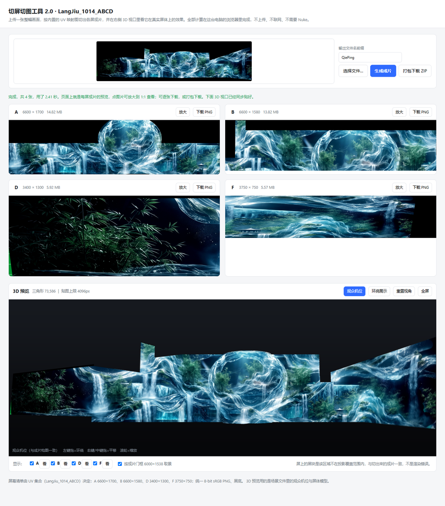
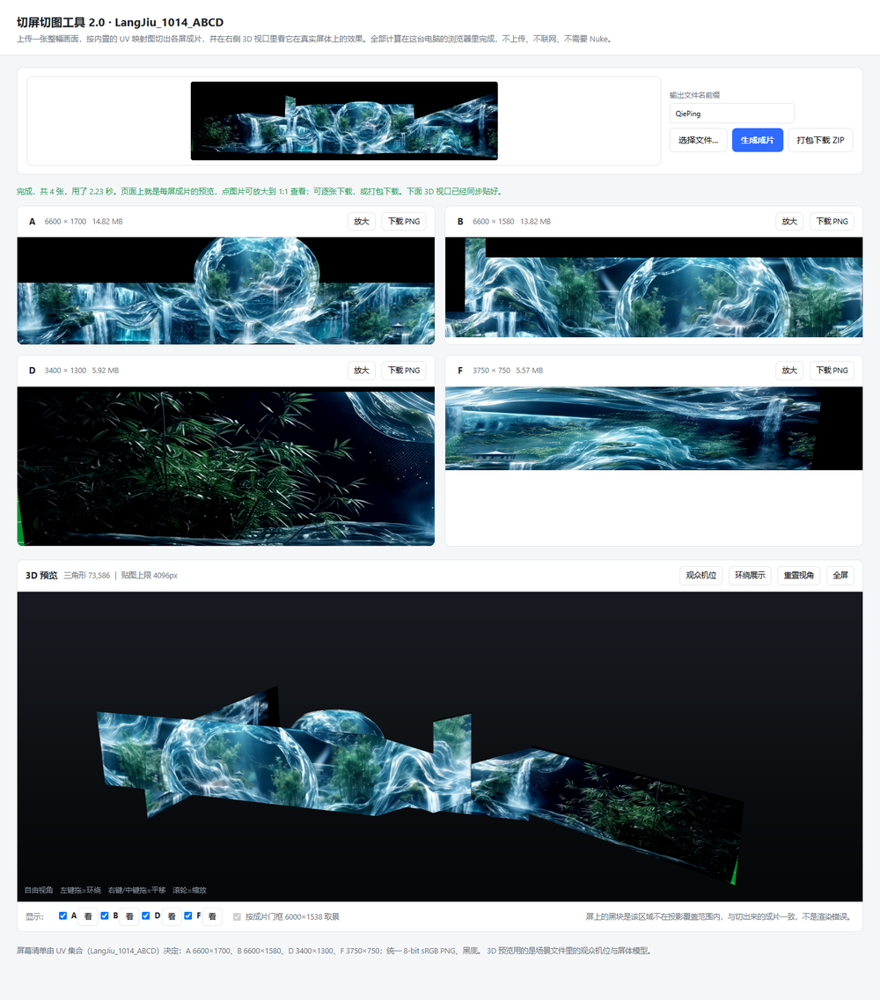
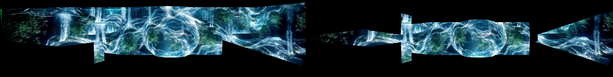

# 3D 预览方案说明（切图贴回真实屏体）

这份文档讲的是网页工具 2.0 新增的 **3D 视口**：切完图之后，直接把四张成片贴到现场屏体模型上，
用**观众机位**看效果，也可以自由环绕、像在 Sketchfab 上看模型一样。





上面两张是同一个工具：上面是四张切图的预览与下载，下面是 3D 视口。
左边一张是「观众机位」——和现场观众看到的构图一致；右边一张是「环绕展示」。

---

## 一、这条路走得通吗：先做一次数值验证

要贴回屏体，前提是模型和切图**用的是同一套坐标**。动手写网页之前先验这一条：

1. 模型（GLB）里有四块屏 `QiePingA / QiePingB / QiePingD / QiePingF`，各带 `TEXCOORD_0`；
2. GLB 里有一台观众相机；
3. 把每个 mesh 顶点用这台相机投影到成片帧（6000×1538），
   再拿该顶点的 UV 去查 Nuke 烤出来的坐标图，得到"按 Nuke 的说法它应该出现在哪"；
4. 两者逐顶点相减，**只统计投影覆盖到的顶点**。

实测（`scripts/verify_3d_cpu.py` 之外单独跑的一次标定）：

| 屏 | 顶点 | 三角形 | 覆盖区平均误差 |
| --- | --- | --- | --- |
| A | 31379 | 61800 | **0.42 px** |
| B | 6036 | 11386 | **0.46 px** |
| D | 121 | 200 | **0.45 px** |
| F | 121 | 200 | **0.66 px** |

6000 宽的帧上平均误差不到 1 像素，说明三件事同时成立：

* GLB 的相机就是 Nuke 的投影相机（位置、朝向、FOV、画幅比都对得上）；
* mesh 的 UV 与切图 PNG 的像素栅格同向同尺度；
* **切图可以直接当贴图贴上去——不用重新烘 UV，也不用做缩放补偿。**

> 注：B 屏另有 1 行顶点的接缝（1580 行里的第 1176 行）在最近邻查表时会跨过坐标跳变，
> 属于查表方式的问题，网页是按三角形插值的，不受影响。

顺便要读出来的还有**面板覆盖度**：A 69%、B 78%、D 100%、F 89%。
没被投影打到的部分在成片里本来就是黑的，所以 3D 预览里必然会出现黑边——
这一点要在界面上写清楚，否则会被当成渲染错误。

## 二、模型怎么处理

Houdini 导出的 GLB 里有 7 个**场景外孤立节点**（其中 `geo1` 是 A 屏的完整副本，
另有 `Came_new_V01`、一台多余的 `cam` 等），先剔掉再做量化：

```bash
python glb_web.py <场景.glb> --out scene --set <坐标集合目录>
```

* POSITION → normalized uint16，真实尺寸/偏移写进**节点矩阵**（`世界坐标 = pmin + q/65535 × span`）；
* TEXCOORD_0 → uint16；索引 → uint16/uint32；丢掉 NORMAL/TANGENT（屏体自发光，用不上法线）；
* **4.95 MB → 0.82 MB**，位置量化误差 7.7e-6 场景单位（约 0.046 px / 6000 帧）；
* 刻意**不用 Draco**：单文件网页不想再背一个解码器。

脚本最后会把刚写出的文件**重读一遍**，核对相机位姿与网格包围盒——这一步抓出过
"矩阵存反了"的致命 bug，务必保留。

## 三、网页侧

`assets/page_template_v2.html` 里内置了一个只吃这个子集的 glTF 解析器和 WebGL2 渲染，
不引任何第三方库，整页仍是**单文件、离线、`file://` 双击可用**。

* **屏体自发光**（直接输出切图颜色，不做光照），非屏体网格给平灰；屏体**关背面剔除**（模型常是双面壳）；
* **观众机位**取场景相机世界矩阵的逆；**自由视角**是轨道相机，从观众机位**无损接管**
  （用当前眼位反推 yaw/pitch/距离，拖一下画面不会跳）；
* 「按成片门框 6000×1538 取景」的开关让观众机位和 Nuke 里的构图完全一致；
* 贴图从切图 canvas 降到长边 4096 再上传（四张全分辨率要 ~115 MB 显存），并 `generateMipmap`；
* 每块屏可单独显隐、可一键把镜头对准它，支持全屏。

## 四、验收

### 1）CPU 黄金对照 vs 原图

在 Python 里用**同一套切图算法 + 软件光栅化**渲一帧观众机位，和原画面比：



左半是原图，右半是把四张切图贴回屏体、从观众机位渲染出来的结果——**四块屏拼起来还原了原画面**，
这就是"切图是对的"最直接的证据。

| 分辨率 / 贴图 | 平均误差 | p50 |
| --- | --- | --- |
| 1560×400，1/4 分辨率切图 | 10.3 / 255 | 6 |
| 3000×769，全分辨率切图 | **5.0 / 255** | 2 |

### 2）无头浏览器端到端

`scripts/browser_test_v2.py` 把成品网页丢进无头 Edge 真跑：投图 → 生成 →
把四张成片和 3D 视口的 canvas 都回传回来比对，`http` 与 `file://` 两种打开方式都要过。

注意判定方式：

* **不能拿 3D 视口和 CPU 对照逐像素比**——GPU 双线性 + mipmap 与 CPU 最近邻采样在
  高频素材上本来就差 30/255。改成**两边都降 8 倍再比结构**（实测 2.2/255，门槛 3）；
* 再加一条**重建 vs 原图**：网页不该比 CPU 对照差（实测网页 8.13，CPU 10.26）；
* 再加一条**敏感度对照**：把素材上下翻转再比，误差必须显著变大（实测 10.6 倍，门槛 3 倍）——
  专门防"v 轴写反"这类不会报错、只会静默出错的 bug。

四张切图本身仍然与 Nuke 成片逐像素比：A 0.881 / B 0.941 / D 0.738 / F 1.543（门槛 平均 ≤2、p90 ≤6）。

## 五、坑（都亲身踩过）

* **glTF 矩阵是列主序。** `np.array(m).reshape(4,4,order="F")` 用来读 1 维数组是对的，
  但对**已经是 4×4 的数组**再用同样写法不会转置（同形状 reshape 是恒等），写出去必须用
  `m.flatten(order="F")`。存反了的表现是：相机跑到原点、画面全空。
* **量化顶点自己算包围盒要除以 65535。** `normalized` 标志只对 GPU 生效；
  用原始 0..65535 算场景中心，中心会到几万米外，near/far 跟着飞走，
  **连观众机位也一起空**。
* **`file://` 页面往 `http://127.0.0.1` POST 图片会先发跨域预检**，
  验收服务器必须实现 `do_OPTIONS`，否则 file:// 模式静默卡死（http 模式看不出来）。
* **别用 `msedge --screenshot --virtual-time-budget` 抓这种页面**：虚拟时钟会抢在
  `createImageBitmap` / `toBlob` 这些真实异步任务前面跑完，截到的是半成品。用 CDP（`shot_page.mjs`）。
* 屏体贴图**不生成 mipmap 会全是噪点**（6600 宽的屏在画面上只占几百像素）。

## 六、换项目怎么复用

1. 用 `skill/remap-split-web/` 里的三步流水线先做出 1.0 的切图工具；
2. 从现场拿一份**和投影相机同一套坐标**的屏体 GLB（四块屏的名字最好带规律，用 `--node-prefix` 指）；
3. 先跑数值标定（本文第一节），**对不上就别往下做**，先查模型坐标系/单位/相机；
4. `glb_web.py` → `build_page_v2.py` → `verify_3d_cpu.py` → `browser_test_v2.py` 四步走完。
