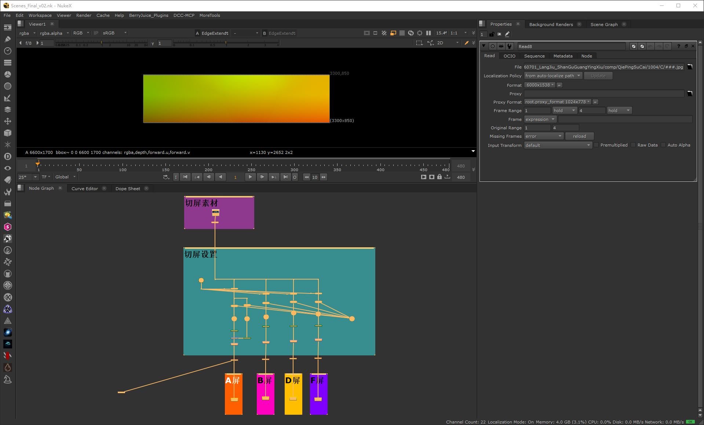
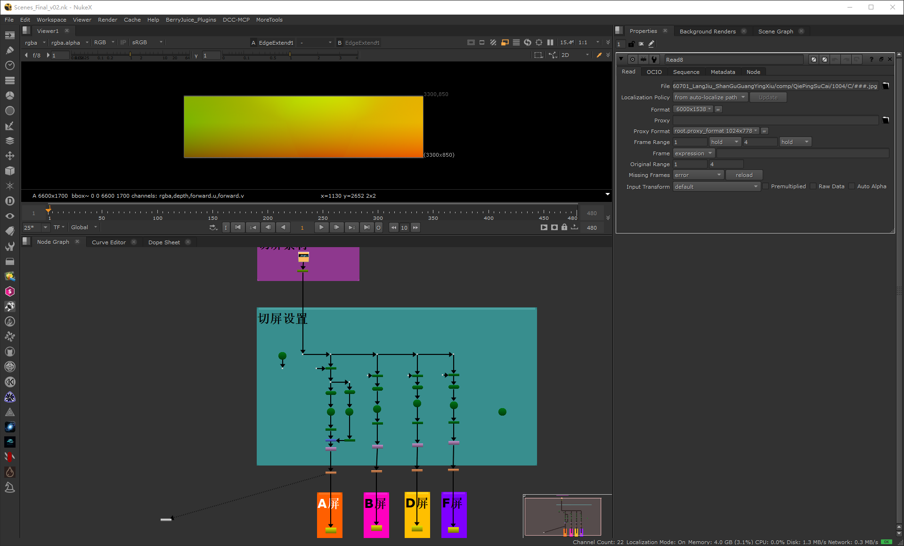
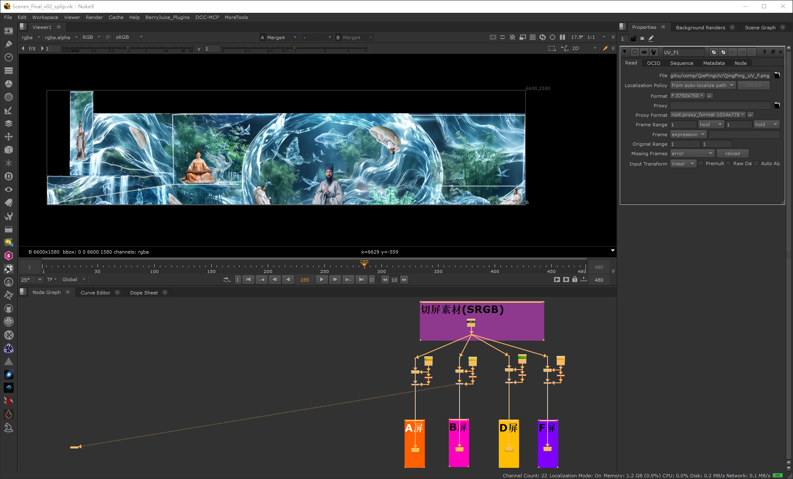
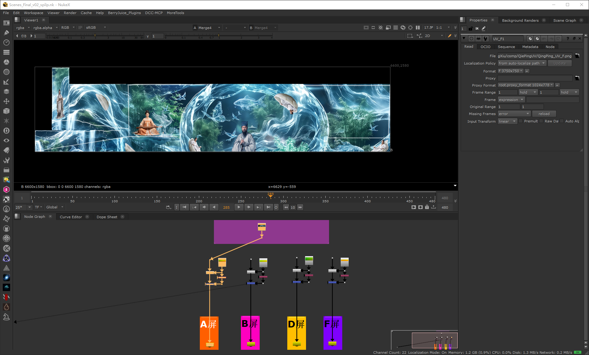

# Nuke 切屏方案说明

这套方案解决一件事：**场地有多块 LED 屏（A/B/D/F），客户给一张整幅画面，
要把它按各屏的实际形状与位置切开，每块屏输出一张成片。**

它分成两条链：

1. **方案一 · 生成素材**（`Scenes_Final_v02.nk`）——用真实机位和屏体模型，
   把"画面 → 每块屏"的映射**烤成一张坐标图**。这一步需要 NukeX。
2. **方案二 · Nuke 内切屏**（`Scenes_Final_v02_spilp.nk`）——拿坐标图做纯 2D 重映射，
   量产切屏。纯 2D，**核心节点就够，不需要 NukeX**，而且每帧成本极低。

同一套坐标图还能喂给网页工具（见第 3 节），给非 CG 的同事出一个"拖张图就出成片"的免安装工具。

---

## 1. 方案一 · 生成素材（`Scenes_Final_v02.nk`）



上图是工程全貌：左上是 Viewer（显示的是坐标图本身——横纵渐变），
下方是节点图，可以看到 `切屏素材`、`切屏设置` 两个分组，以及最下面四块屏各自的 Write。

每块屏一条链，结构完全一样：

```
Read(素材) ─┐
            ├─ Project3D2 ─ ReadGeo2(屏体 FBX) ─ Scene ─ ScanlineRender ─ Reformat ─ EdgeExtend ─ Write
Camera3 ────┘
```



逐项说明：

| 节点 | 作用与要点 |
| --- | --- |
| `UV_Map`（Group） | Nuke 自带的 UV Map gizmo。核心是一个 `Expression`：`expr0 = (x+0.5)/width`、`expr1 = (y+0.5)/height`，把画面变成**归一化坐标场**（0–1）。 |
| `Camera3` | 从 `Came_new_V01.abc` 读进来的真实机位（`read_from_file true`）。**坐标是按这个机位投影出来的**。 |
| `ReadGeo2` ×5 | 每块屏一个 FBX 模型（`A_ping_A_A`、`A_ping_C_E`、`B_ping_D`、`D_ping_E_v03`、`F_ping_B`）。 |
| `Project3D2` | 把画面按机位投影到屏体上。 |
| `ScanlineRender` | `projection_mode uv`、`antialiasing high`、`conservative_shader_sampling false`。 |
| `Reformat` | `resize distort`，format 设成该屏的**真实分辨率**——**输出尺寸由这里决定**。 |
| `EdgeExtend` | `sourceIsPremultiplied true`、`premultiply false`，把屏体轮廓外的坐标往外延，免得边缘一圈是脏的。 |
| `Write` | `file_type png`、`datatype 16 bit`、`channels rgba`、`colorspace linear`。**坐标是数据，绝不能被色彩管理动过。** |

**产物**（写到 `comp/QiePingUV/`）：

| 文件 | 分辨率 | 通道含义 |
| --- | --- | --- |
| `QingPing_UV_A.png` | 6600 × 1700 | R = 横向坐标 u、G = 纵向坐标 v、B = 0、A = 覆盖率 |
| `QingPing_UV_B.png` | 6600 × 1580 | 同上 |
| `QingPing_UV_D.png` | 3400 × 1300 | 同上 |
| `QingPing_UV_F.png` | 3750 × 750 | 同上 |

约定：u/v 已**归一化到 0–1**，**v 的原点在左下**（Nuke 惯例）。
A（覆盖率）是屏体的 alpha，自带抗锯齿边缘。

**换机位 / 换屏体**：改 `Camera3.file`、各 `ReadGeo2.file`、各 `Reformat.format`，
然后重渲一遍素材即可。只换素材不用动这个工程。

---

## 2. 方案二 · Nuke 内切屏（`Scenes_Final_v02_spilp.nk`）



上图是全貌：顶上一个 `切屏素材(SRGB)` 分组（只有那个 Read），
中间四组并列的切屏链，下面四个 `A屏 / B屏 / D屏 / F屏` 的 Write。



每块屏一条链：

```
Read(素材) ────────────────┐
                           ├─ STMap ─ Merge2(operation=multiply) ─ Write
Read(UV_<屏>.png) ─────────┘    ▲                ▲
                                └── Shuffle2     └── 覆盖率
                                    (alpha → rgb)
```

**七条要点，每一条都踩过坑：**

1. **`STMap` 的 input 0 是 src、input 1 才是 map**——和直觉相反，接反了输出完全乱。
2. **`uv` 通道默认是 `none`**，这时 STMap 不报错、直接把 src 原样吐回来，
   极易误判成"这节点没用"。必须设成承载 u/v 的通道：`rgba`。
3. `filter` 选 **Mitchell** 最贴合（实测 cubic / Lanczos4 / impulse 都更差）。
4. 坐标图要按 **`colorspace linear`** 读——它是数据，不是颜色。
5. 覆盖率：用 `Shuffle2` 把坐标图的 alpha 铺到 RGB（三通道同值），再用
   **`Merge2`（operation = multiply）** 乘上去。
6. **`nuke.nodes.Multiply()` 不是 Merge 版的乘法**——它是 Color 菜单里"乘常数"的节点，
   第二路输入会被**无声忽略**。症状是屏体外面漏出素材角落的颜色；
   素材角落恰好是纯黑时完全看不出来，非常阴。
7. **不要在前面加 `Reformat`**。STMap 的输出分辨率自动跟随映射图；
   加 Reformat 等于让素材重采样两次，误差明显变大。

**换素材只改那一个 `Read` 的路径**（案例里是 `Read1`）。换机位要重烤坐标图（回到方案一）。

---

## 3. 同一套坐标图的第二种用法：网页切图工具

方案二把坐标图喂给 `STMap`；同一套坐标图也可以喂给一个**单文件网页**：
上传一张图，直接在浏览器里算出 A/B/D/F 四张 PNG。给非 CG 的同事用，
不需要装 Nuke、不需要授权、离线可跑。

网页端的算法与 `STMap` 等价：

```
out(x,y) = 素材_双线性_线性空间( u*W - 0.5 , (1-v)*H - 0.5 ) * 覆盖率(x,y)
```

但有四个必须守住的约束（踩过才知道）：

1. **坐标要 16-bit**。8-bit 坐标在大幅面上会切成几十像素宽的糊块：
   同一工程实测，8-bit 平均误差 18–27/255，16-bit 是 0.9/255。
   浏览器读不了 16-bit 多通道 PNG，所以拆成"高 8 位 / 低 8 位"两个通道存。
2. **不能把坐标写进 alpha 通道**。浏览器上传带 alpha 的贴图时会把 RGB 按 alpha 预乘，
   数据直接毁——所以拆成两张 RGB。
3. **v 轴要翻转**：坐标的 v 原点在左下，而浏览器贴图的 `v=0` 是图像第一行（顶部），
   采样素材时要写 `1.0 - v`。
4. **插值在线性空间做**，且 16-bit 坐标**不能交给硬件插值**
   （高低位分开存时，GPU 的亚像素误差会被放大 256 倍），必须自己拆位后再插值。

打包好的网页与 Nuke 成片逐像素比对，平均误差 **0.88 / 0.94 / 0.74 / 1.55**
（A/B/D/F，单位 8-bit/255），肉眼不可辨。

完整做法（导出脚本、打包、出网页、验收）见 `skill/remap-split-web/`，
那里有一份可复用的技能与全部脚本。

---

## 4. 验收数据

**坐标精度**（同一个 Nuke 工程、同样节点，只换映射来源，素材 `1004/C/001.jpg`）：

| 映射来源 | 平均误差 | p90 | 差异 >2 的像素 |
| --- | --- | --- | --- |
| 16-bit 坐标（现用） | **0.9 / 255** | 2 | — |
| 8-bit 坐标 | **17.9 / 255** | 51 | 65% |

**网页工具 vs Nuke 成片**（同一张素材，最后一行是逐像素差）：

| 屏 | 分辨率 | 平均误差 | p90 |
| --- | --- | --- | --- |
| A | 6600 × 1700 | 0.881 | 2 |
| B | 6600 × 1580 | 0.941 | 2 |
| D | 3400 × 1300 | 0.738 | 2 |
| F | 3750 × 750 | 1.549 | 3 |

---

## 5. 常见坑速查

| 现象 | 多半是 |
| --- | --- |
| STMap 输出和输入一模一样 | `uv` 通道没设（默认 `none`） |
| 输出完全乱 | STMap 两个输入接反了（input 0 是 src、input 1 是 map） |
| 屏体外漏出素材角落的颜色 | 用了 `Multiply` 节点而不是 `Merge2` 的 multiply |
| 画面整片发绿/发暗 | 遮罩写成了单通道灰度图，乘的时候绿蓝被乘 0 |
| 屏体边缘一圈脏 | 坐标图没做 EdgeExtend，或坐标是被 alpha 预乘过的 |
| 画面糊成几十像素的块 | 坐标只有 8-bit 精度 |
| 整张图上下颠倒 | v 轴没翻转（贴图 v=0 在顶部，坐标 v 原点在左下） |
| Nuke 报 UnicodeDecodeError | 脚本路径里有中文，先把脚本拷到纯英文路径 |
| 写出来的文件名少了几个字符 | Nuke 的 Write 会吃掉路径里的反斜杠，一律用正斜杠 |

更完整的踩坑清单见 `skill/remap-split-web/references/pitfalls.md`。
